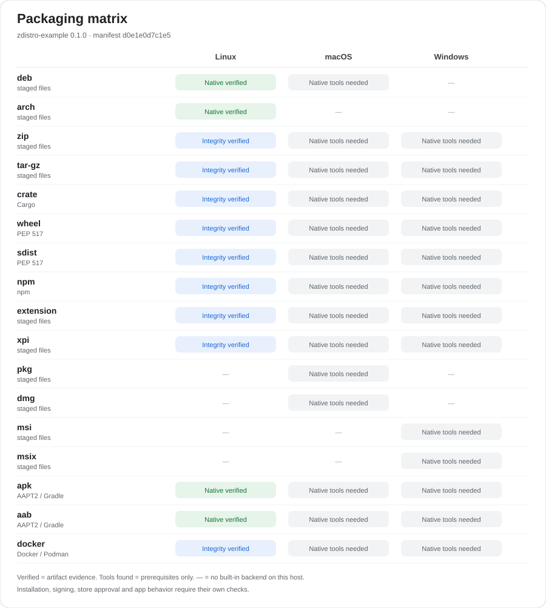

# zdistro

**一个模板，连接语言构建、文件暂存和各平台的打包工具。**

zdistro 把软件包拆成三个可组合步骤：先调用 Cargo、Python、npm 或你声明的构建命令；再把产物映射到统一暂存目录；最后交给目标格式的原生工具，生成包并校验。核心运行时使用 Python 3.11+ 标准库。

内置 17 个输出后端，涵盖 Debian/Ubuntu、Arch、Windows、macOS、Android、Python、Rust、npm、浏览器扩展和容器。其他语言与格式通过显式 argv 配方接入。每个后端都保留自己的 SDK、签名和格式要求。

## 开始使用

```sh
git clone https://github.com/LIghtJUNction/zdistro.git
cd zdistro
python -m pip install .

zdistro init demo --name hello-package --target deb,arch,zip
zdistro doctor --manifest demo/zdistro.toml
zdistro plan --manifest demo/zdistro.toml
zdistro build --manifest demo/zdistro.toml --target zip
```

`init` 生成可编辑的 `zdistro.toml`、最小样例和明确的前置条件。把文件映射改成自己的软件，填写维护者、版本和许可证后即可构建。已有文件会保留。支持 `ubuntu`、`rust`、`python`、`安卓`、`浏览器插件`、`容器` 等常用别名。

```sh
zdistro init multilingual --target python,rust,浏览器插件,安卓,容器
zdistro build --manifest multilingual/zdistro.toml --available
```

`--available` 构建当前主机已满足条件的目标，并逐项列出跳过原因。默认构建遇到前置条件缺失会返回非零退出码。

## 六个入口

| 命令 | 做什么 | 输出 |
|---|---|---|
| `init --target …` | 生成统一模板及对应最小样例 | TOML 与源文件 |
| `doctor` | 检查当前主机、工具、项目文件和 SDK；容器目标检查引擎 | 文本或 `--json` |
| `plan` | 展示构建器、文件映射、原生命令和缺失条件 | JSON；不运行构建命令 |
| `build` | 私有目录构建、生成包、调用验证器 | 产物与 `receipt.json` |
| `verify RECEIPT` | 检查配置指纹、产物 SHA-256/大小并重新验证格式 | JSON |
| `matrix --format svg` | 根据模板、主机工具和实际收据生成矩阵 | SVG、JSON 或 Markdown |

构建结果放在 `dist/zdistro/<格式>/<本次构建>/`。失败记录为 `failure.json`；只有成功生成并验证的非空产物才有成功收据。收据同时记录主机、源配置指纹、命令结果、文件摘要和验证范围。

## README 打包矩阵

```sh
zdistro matrix --manifest demo/zdistro.toml \
  --format svg --output demo/docs/packaging.svg
```

在自己的 README 中嵌入：

```md

```

矩阵从实际数据计算。`Native verified` 表示产物通过原生格式工具检查；`Integrity verified` 表示归档、元数据或内容摘要检查通过；`Recipe verified` 表示用户声明的验证命令成功。`Tools found` 是当前主机的前置条件结果，`Native tools needed` 表示另一主机需要相应工具。已有收据对应的产物缺失时显示 `Receipt only`。配置指纹变化或产物被修改会撤销对应验证状态。

本项目使用的样例验收入口是 `tests/native_smoke.py`。三平台 CI 上传实际包、收据、SDK 检查结果和矩阵，见 [Actions](https://github.com/LIghtJUNction/zdistro/actions)。产物校验、安装测试、签名和商店提交分别记录，矩阵展示产物校验范围。


上图是本机实际产物校验时生成的快照，数据见 [packaging.json](docs/packaging.json)。其他系统的正式构建证据在 Actions 制品中；这个 Linux 快照不会把其他系统的工具适配标成已经实测。

## 统一模板

```toml
schema = 1
source_date_epoch = 1700000000

[package]
name = "my-app"
version = "1.0.0"
description = "My application"
maintainer = "Maintainer <maintainer@example.org>"
license = "MIT"
identifier = "org.example.myapp"

[build]
kind = "cargo"
project = "rust-app"

[[files]]
source = "{build}/cargo/release/my-app"
destination = "usr/bin/my-app"
mode = "0755"

[targets.deb]
architecture = "amd64"
depends = ["libc6"]

[targets.arch]
architecture = "x86_64"
release = "1"
depends = ["glibc"]

[targets.zip]
files = [{source = "{build}/cargo/release/my-app", destination = "my-app"}]
```

语言构建器在独立的源副本中运行；`{build}` 指向这次构建的私有目录。`files` 只接收项目内的源文件或本次构建产物，目标路径使用相对 POSIX 路径。每个目标可以覆盖 `files`，因此同一个程序可以使用不同的安装布局。架构字段描述装入包内的程序，跨编译由语言工具链及其 `build.target` 负责。

`crate` 调用正常的 `cargo package`，保留其拆包后构建验证；`wheel`/`sdist` 调用 PEP 517 前端 `python -m build`；`npm` 调用 `npm pack --ignore-scripts`。Python 打包需要在运行 zdistro 的环境安装 `build`，项目后端依赖由 PEP 517 的隔离构建处理。[Cargo](https://doc.rust-lang.org/cargo/commands/cargo-package.html) · [Python packaging flow](https://packaging.python.org/en/latest/flow/) · [npm pack](https://docs.npmjs.com/cli/v12/commands/npm-pack/)

## 扩展语言和格式

`build.kind = "command"` 接入任意已经存在的语言构建工具。新包格式通过 `recipes` 登记，并与内置后端共用暂存目录、检查和收据：

```toml
[targets.custom]

[recipes.custom]
hosts = ["linux", "macos", "windows"]
tools = ["my-packager", "my-package-check"]
artifact = "my-app.bundle"
build = [["my-packager", "--root", "{stage}", "--output", "{artifact}"]]
verify = [["my-package-check", "{artifact}"]]
```

把配方中的工具换成该生态实际使用的构建器和验证器即可。两组命令都必填；命令失败、产物缺失或为空都会结束构建。参数按数组传递；占位符包括 `{python}`、`{project}`、`{stage}`、`{build}`、`{work}`、`{out}`、`{artifact}`、`{name}` 和 `{version}`。模板和构建脚本是可执行的项目配置，应在 `plan` 中审阅后运行。

独立 `verify` 会按原来的 `targets.<target>.project` / `build.project` 重新复制配方项目；`{work}`、`{build}`、`{stage}` 是新的临时目录，先前的中间产物不会恢复。验证命令应检查 `{artifact}`，需要的辅助脚本放在 `{project}` 中。

具体原生工具、格式规则和官方来源见 [格式指南](docs/formats.md)。

## 开发与验收

```sh
python -m unittest discover -s tests -v
python tests/native_smoke.py --targets deb,arch,zip,tar-gz
```

测试覆盖路径和文件映射、真实归档、扩展资源引用、配方产物/验证契约、嵌套项目重验、收据篡改、配置变更失效、可重复 ZIP 和矩阵状态。原生构建工作流负责 Linux Deb/Arch、macOS PKG/DMG、Windows MSI/MSIX，以及使用现有 SDK 的 Android APK/AAB 检查。Android 还检查真实应用标识和版本，拒绝版本不符的有效 APK。SDK 或工具缺失会显示具体前置条件。

日常修改在本机验收；GitHub 工作流仅用于显式启动或版本标签触发的正式原生制品构建。仓库自身的 `zdistro.toml` 可生成 zdistro 的 wheel、sdist、可运行 zipapp、Deb 和 Arch 包：

```sh
python -m pip install build
python -m zdistro build --manifest zdistro.toml --target wheel,sdist,zip
```

本项目属于 [Project Z](https://github.com/LIghtJUNction/project-z)。公共接口或依赖变更按反向依赖传播：维护者负责协调、更新并验证直接及间接消费者，再提交相关变更。

## 许可证

zdistro：MIT，见 [LICENSE](LICENSE)。被打包的软件及调用的外部工具保留各自的许可证。
